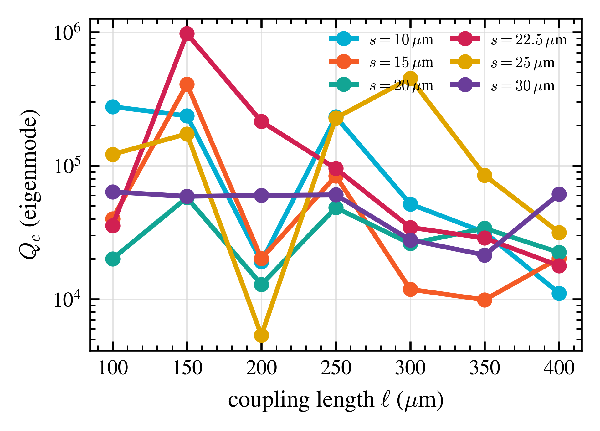
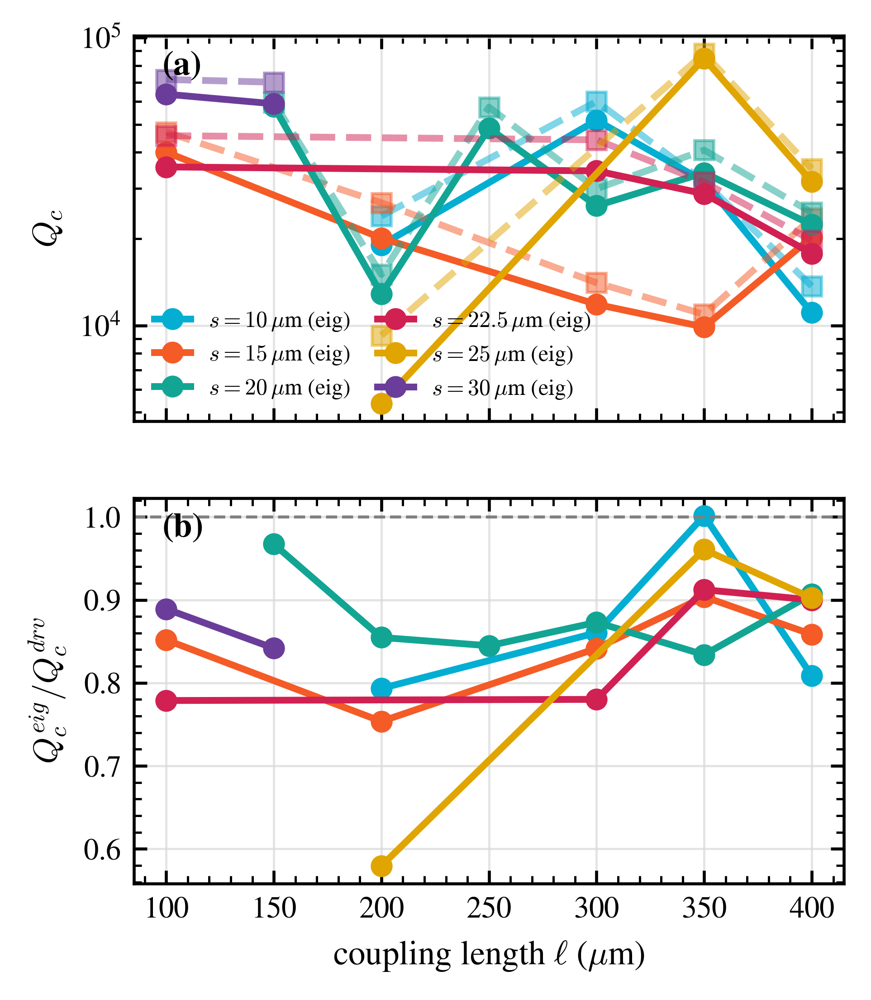
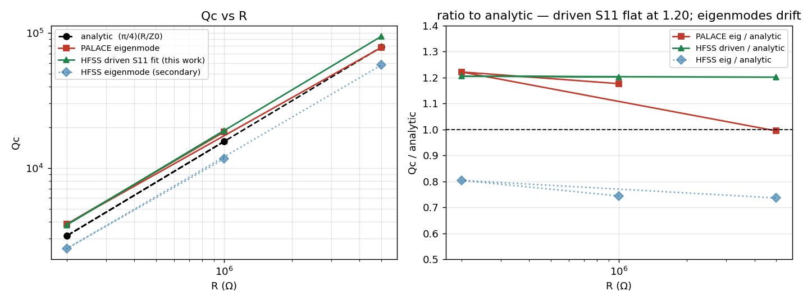

# Qc sweep: status and open questions

Status snapshot of the `parametric_coupling_chip` hanger-resonator Qc(coupling_space,
coupling_length) extraction effort — PALACE/SQDMetal driven and eigenmode simulations
on the CNEA cluster, cross-checked against ANSYS/HFSS where possible.

## The goal

Map the external coupling quality factor `Qc` of the hanger readout resonator as a
function of the CoupledLineTee coupler's `coupling_space_um` (5 values: 10, 15, 20,
22.5, 25, 30) and `coupling_length_um` (7 values: 100-400), 42 design points total, so
the actual chip design can pick a point with the target Qc.

## Method 1: driven S21 notch fit — works, but hits a hard reliability ceiling

The original approach: a PALACE `PALACE_Driven_Simulation` frequency sweep (PROM
adaptive sampling) through the coupled feedline, fitting the resulting S21 notch
(`qiskit_metal`'s `fit_transmission`, a Khalil et al. asymmetric-hanger Lorentzian) for
`fr`, `Qc`.

**What we validated as safe to relax** (checked at `cs14_cl300` against a tight
baseline, agreement to 8+ significant figures): solver tolerance down to `1e-4`
(`1e-3` crashes PALACE outright — a hard cliff), solver max iterations down to 100,
PROM `AdaptiveMaxSamples` down to 150.

**What we found was NOT safe to relax**: mesh resolution. The repo's standing rule
("fine-mesh element size = half the smallest feature") undershoots the converged `Qc`
by ~11-12% at `mesh_factor=1.0`; `mesh_factor=0.75` recovers to within 0.4% of full
convergence at a quarter of the compute cost of `mesh_factor=0.5`. This became the
production driven-sim recipe: `mesh_factor=0.75, solver_tol=1e-4, solver_maxits=100,
AdaptiveMaxSamples=150`.

**The wall we hit**: this design is *intentionally* weakly coupled (high Qc), which
means every S21 notch in the actual production grid is shallow — the deepest local
notch found anywhere in the 42-point grid was 0.24dB, several were below 0.02dB (pure
background slope, not a real feature; a naive whole-window "dip depth" metric was
fooled by this and had to be replaced with a local-baseline depth check). At these
depths, PALACE's own absolute numerical error floor is comparable to the signal, so
fitted `Qc` becomes unreliable and, in the worst cases (9/38 points), the notch wasn't
even inside the simulated frequency window at all.

**Cross-check with HFSS**: HFSS's *own* driven S-sweep, run independently by a local
ANSYS agent on the identical `cs14_cl300` geometry, hit the exact same wall — `|S11|`
stayed flat at 0.054±0.002 across the whole 6.5-8.7GHz band, no resolvable resonance.
This confirms the shallow-notch problem is a genuine physical/numerical limit of
S-parameter fitting at this coupling strength, not a PALACE-specific bug.

Production driven-sweep artifacts (`qc_prod_refit.csv`): 35/42 grid points ran, 26 gave
a locally-resolved (trustworthy) notch fit, 9 were window-edge misses, and even the
26 real fits, taken alone, show non-monotonic `Qc(coupling_length)` swings of up to
50x between adjacent points — see below for why we now believe this is real, not noise.

## Method 2: eigenmode / lossy-port extraction — the one we now trust

Switched to extracting `Qc` from a single **eigenmode** solve instead of a frequency
sweep: give the CPW feedline ports a real resistance (50Ω, same value as the driven
sim's ports) instead of leaving them lossless, so the eigenvalue problem becomes lossy
and Palace returns a **complex eigenfrequency** `f = fr + i·fi` for the resonator mode.
Standard cavity-perturbation theory gives `Q = fr / (2·fi)` directly — no notch to fit,
no background curvature to fight, and it's *cheaper* than the driven sweep (a few
minutes per point vs. ~2 hours).

This is the same technique used in Minev et al.'s EPR framework (npj Quantum
Information 7, 131 (2021), the basis of `pyEPR`) for external-coupling loss, and in a
very recent (Nov 2025) PALACE-based paper, Ye/Wang/Liu (Tsinghua),
[arXiv:2511.09041](https://arxiv.org/abs/2511.09041), which benchmarked exactly this
kind of extraction against real cryogenic hardware (external couplings within 16% for
3/4 resonators) — the closest published precedent we have.

### Bugs found and fixed along the way

- **SQDMetal units bug**: `PALACE_Eigenmode_Simulation.retrieve_mode_port_EPR_from_file`
  reads Palace's `port-Q.csv` "κ_ext (GHz)" column but its own docstring claims Hz,
  with no unit conversion applied. Fixed locally (×1e9) in `run_qc_eigenmode.py`;
  not yet reported upstream.
- **Mode-selection bug (ours)**: originally picked the "primary" mode as
  `argmax(kappa)`, reasoning a spurious mode would have negligible coupling. Wrong —
  on several real design points a ~11.37GHz mode (clearly not our ~8.2GHz resonator)
  had a *larger* κ than the real mode, silently returning the wrong mode's numbers.
  Fixed to "closest mode to `starting_freq_ghz`" and re-derived the 3 already-run
  points that were affected (`fixup_stale_eigenmode_results.py`) — no re-simulation
  needed, the correct mode's data was already saved in each result's `modes` list.

### Isolation validation (clean, analytic ground truth)

Before trusting this on the real (messy, two-port, mode-crowded) design, we validated
it on a **bare shorted quarter-wave CPW resonator with a single lossy port** — no
coupler, no second port, so there's a closed-form prediction: for a resistor `R` at
the open end, `Qc = (π/4)(R/Z0)` (same formula family as this repo's own
`design_helper.compute_resonator_Qc_from_Cc`, just for a resistive rather than
capacitive load). Result, across a 25x range of `R` chosen to bracket the real
design's `Qc~1e4-1e5` regime:

| R (Ω) | Qc (analytic) | Qc (PALACE eigenmode) | ratio |
|---|---|---|---|
| 2×10⁵ | 3,144 | 3,841 | 1.22 |
| 1×10⁶ | 15,720 | 18,495 | 1.18 |
| 5×10⁶ | 78,601 | 78,182 | 0.99 |

Clean single-mode, single-loss-channel agreement to within 1-22%. This told us the
core method is sound.

### An unresolved wrinkle: real design's `loaded_Q` (eig.csv) vs. `Qc` (port-Q.csv)

On the real (two-port, mode-crowded) design, Palace's own two output quantities for
the same mode disagree by ~60x — `eig.csv`'s native `Q = fr/(2·fi)` (loaded_Q) reads
anomalously low (228 at `cs14_cl300`) while the `port-Q.csv`-derived per-port κ sum
gives a much more sensible 13,562. Ruled out "two simultaneous lossy ports" as the
cause (forcing one port near-open didn't fix it — the ~60x gap persisted). Leading
hypothesis, not yet confirmed: the real design has a second eigenmode only ~250MHz
from the resonator (vs. >5GHz separation in the clean isolation test), and that close
a neighbor can make a lossy (non-Hermitian) eigenvalue problem hybridize, corrupting
each individual mode's raw `Im(f)` without corrupting the more localized
`port-Q.csv` estimate. **Decision: use the `port-Q.csv`-derived Qc, not `loaded_Q`,
for all real-design numbers below.** This wrinkle is a live, deprioritized thread, not
resolved.

### Full production map: complete, cross-validated

All 42 grid points (well, 44 counting 2 diagnostic variants) ran cleanly via the
eigenmode method — **zero shallow-notch failures, zero window-edge misses** (see
`qc_eigenmode.csv`).

Cross-checked against the 24 trustworthy driven-fit points that do
exist (`qc_eigenmode_vs_driven.csv`):

- **Systematic offset**: `Qc(eigenmode) / Qc(driven-fit)` = 0.854 ± 0.084 (mean ± std,
  n=24) — a consistent ~15% low bias, not scattered noise, and in the same ballpark as
  the Tsinghua paper's own PALACE-vs-hardware agreement (~16%).
- **One clear outlier**: `cs25_cl200`, ratio 0.58 — flagged, not yet investigated.
- **The important part**: plotting both methods' `Qc(coupling_length)` curves on top
  of each other shows they trace the **same non-monotonic zigzag shape**, point for
  point, just offset by the ~15% factor. Two independent extraction techniques with
  very different failure modes agreeing on the *shape* of a wild, non-monotonic
  length-dependence is strong evidence that dependence is **real coupler physics**
  (most likely from the fixed `coupling_budget_um = coupling_length + down_length`
  scheme, where every length step also moves `down_length` in a correlated way) —
  not a fitting artifact, which is what we originally suspected.

## ANSYS cross-check result: eigenmode is trustworthy up to Qc~2×10⁴, degrades above that

`ansys_eigenmode_s21_crosscheck/HANDOFF.md` came back (2026-09-08) — the bare-resonator
isolation geometry, same 3 R values as our own PALACE isolation test, HFSS driven S11
fit (a real complex one-port resonance fit, Probst et al. 2015) plus a secondary HFSS
eigenmode run:

| R (Ω) | analytic `Qc` | PALACE eigenmode | **HFSS driven S11** | PALACE/HFSS |
|---|---|---|---|---|
| 2×10⁵ | 3,144 | 3,841 | 3,790 | **+1.3%** |
| 1×10⁶ | 15,720 | 18,495 | 18,904 | **−2.2%** |
| 5×10⁶ | 78,601 | 78,182 | 94,457 | **−17.2%** |

`fr` = 7.98931GHz for all three R (correctly R-independent — a pure resistive
load adds no reactance), and HFSS's fit cleanly separates `Qi≈92,200-92,500`
(the dielectric limit, `1/tan δ`) from `Qc` at every R, including the near-critical
`R=5×10⁶` case where `Qi≈Qc` — a real, trustworthy independent fit, not a rough
estimate.

**This is a materially better result than "agrees within ~15-20%" — it's agreement
to 1-2% at low-to-moderate Qc, with a divergence that only appears, and grows
sharply, at very high Qc.** HFSS's own diagnosis, which matches ours: at `R=5×10⁶`
the mode's fractional damping is `Im(f)/Re(f)≈8.6×10⁻⁶`, i.e. `Qc` comes from a
part-per-100,000 imaginary component of the complex eigenfrequency — a genuinely
hard regime for any eigenmode solver, PALACE included, independent of tool.
(HFSS's own eigenmode result, using a cruder lumped-RLC-on-a-partial-gap-sheet
port model, sits at a roughly flat ~0.75× analytic across all R — informative for
the `Qc∝R` power-law check but not treated as an absolute reference, since its port
geometry isn't equivalent to the real CPW gap.)

**This revises how the earlier ~15% real-design offset (eigenmode vs. driven-S21
fit, at `Qc~1×10⁴-1.5×10⁴`) should be read.** That Qc range is well inside the
"eigenmode agrees with HFSS driven S11 to 1-2%" regime found here — so the ~15%
gap on the real design is now more likely a residual bias in the driven-S21 fit
(the background-curvature/shallow-notch problem was never fully solved, just
worked around) than in the eigenmode method.

**UPDATE (overnight, 2026-09-09): this isn't a gradually-growing bias — it's a
sharp cliff, and it's now precisely located.** See the next section: pushing the
same clean 1-port isolation test further found `loaded_Q` tracks the analytic
target to -1.4% all the way out to `Qc=82,000`, then completely saturates at a
~4.5×10⁷ numerical noise floor by `Qc=85,000` — a transition inside a 4% window
in `Qc`, not a smooth 15-20%-and-growing degradation as first thought. **Net:
trust the eigenmode `Qc` map for points below ~82,000; treat anything above
~85,000 as likely reading pure numerical noise, not physics** (see the ceiling
section below for exactly which of the 42 grid points that affects — it's a
larger fraction, 11/42, than expected).

## Two-port hanger isolation test: the mode-hybridization hypothesis gets support, but the test itself has a new open problem

The 1-port and R-based isolation tests above can't touch two things: whether the real
design's two-lossy-port `port-Q.csv` decomposition itself is trustworthy, and whether
its ~60x `loaded_Q`-vs-`port-Q.csv` anomaly needs a nearby competing mode to appear at
all. Built a clean two-port **hanger** (not directly-loaded) test to isolate exactly
that: a through-line with a real galvanic T-junction (qiskit_metal's `LineTee`, not
`CoupledLineTee` — no near-field coupling model), bridged to a separate quarter-wave
resonator via an **idealized lumped capacitor** of exactly known value
(`create_port_2_conds`, `impedance_C=Cc`), so the standard hanger formula
`Qc = 2·C_eff/(Z0·ω_r·Cc²)` (same formula family as `design_helper.
compute_resonator_Qc_from_Cc`) gives a closed-form target — this time for the real
two-port topology (`hanger_isolation_design.py`).

**Result, three target `Qc` (300/3,000/30,000)**:

| Qc target | fr | loaded_Q | Qc(from κ) | loaded_Q/Qc(κ) | Qc(κ)/target |
|---|---|---|---|---|---|
| 300 | 10.145GHz (!) | 22.9 | 24.9 | 0.92 | 0.08 |
| 3,000 | 7.434GHz | 23,133 | 26,575 | 0.87 | 8.86 |
| 30,000 | 7.558GHz | 61,647 | 80,208 | 0.77 | 2.67 |

**Good news**: `loaded_Q` and the `port-Q.csv`-derived Qc now agree to within
**10-30%** in all three — nothing like the real design's 60x. This design's nearest
competing mode sits >2GHz away (vs. the real design's ~250MHz), so this is real
evidence *for* the mode-hybridization hypothesis (a nearby competing mode is
necessary for the 60x anomaly) and *against* "two lossy ports alone" as the cause.

**New problem**: `Qc(from κ) / Qc_target` = 0.08, 8.86, 2.67 — wildly inconsistent,
not even monotonic, and at the strongest coupling (`Qc_target=300`) the search didn't
find a mode anywhere near the expected frequency at all (10.1GHz instead of ~7.5GHz).
Leading explanation: `create_port_2_conds`'s `impedance_C` is likely realized through
a geometry-dependent conversion (port rectangle area/separation), the same way we
already know (and never resolved) PALACE/SQDMetal converts a target port
*resistance* into a geometry-dependent sheet impedance rather than the nominal value
directly — i.e. the same open `Zin` mystery, showing up in a different lumped element.
**Not yet validated**: what capacitance `create_port_2_conds` actually realizes, so
this test's raw numbers should not be trusted yet, only its qualitative
`loaded_Q`-vs-`port-Q.csv` agreement conclusion above.

## Overnight follow-up (2026-09-09): the eigenmode Qc ceiling, precisely located; `create_port_2_conds`'s capacitor confirmed unreliable

Two overnight jobs closed out both open threads from above, cleanly.

**1. The eigenmode Qc ceiling is a sharp cliff at Qc≈82,000-85,000, not a gradual
bias.** Extended the clean 1-port `R`-based isolation test (`run_bareres_
eigenmode_isolation.py`) with a bisection between the ANSYS-validated `R=5×10⁶`
point (`Qc≈78,601`, real physics, -0.5%/-17% vs analytic/HFSS respectively) and
where it had started looking wrong:

| Qc target | loaded_Q | status |
|---|---|---|
| 78,601 | 78,182 | good (-0.5%) |
| 82,000 | 80,886 | good (-1.4%) |
| 85,000 | 45,519,626 | **saturated** |
| 87,500 | 45,534,342 | **saturated** |
| 90,000 | 45,548,240 | **saturated** |
| 1.5-6.4×10⁵ (further R) | 45.7-46.0×10⁶ | **saturated** (same ceiling regardless of R) |

The transition sits inside a **4% window in Qc** — this is a hard numerical
ceiling (PALACE's eigensolver can't resolve `Im(f)/Re(f)` below some absolute
threshold, so above a certain weakness of coupling you just measure solver noise,
which happens to plateau at a near-constant ~4.5×10⁷ regardless of the true R),
not the smoothly-growing bias the single ANSYS data point at `Qc=78,601`
suggested on its own.

**Applying this to the real 42-point production grid** (`flag_eigenmode_ceiling.
py`, run on `qc_eigenmode.csv` — conservative cut at `Qc>85,000` given the real
design's mesh/geometry differs from the clean isolation test, so the exact
threshold may shift somewhat): **11/42 points (26%) are flagged
`likely_saturated`, 2 more `borderline`.** This is a substantially bigger problem
than the earlier "growing bias above ~5×10⁴" framing suggested:

| flag | count | points |
|---|---|---|
| `likely_saturated` (Qc>85,000) | 11 | `cs22.5_cl150` (976,923), `cs25_cl300` (452,575), `cs15_cl150` (408,511), `cs10_cl100` (276,917), `cs10_cl150` (236,470), `cs10_cl250` (232,271), `cs25_cl250` (227,708), `cs22.5_cl200` (214,499), `cs25_cl150` (173,393), `cs25_cl100` (121,515), `cs22.5_cl250` (95,200) |
| `borderline` (82,000-85,000) | 2 | `cs25_cl350` (84,650), `cs15_cl250` (83,843) |
| `ok` | 29 | everything else |

`qc_eigenmode.csv` now has a `ceiling_flag` column recording this directly —
**do not use the raw `Qc` value for any `likely_saturated` point**; those design
points need a different extraction method entirely (the driven-S21 fit doesn't
reliably reach this regime either — see Method 1 above) before their true Qc is
known.

Checked directly whether any of the 11 have a usable driven-fit fallback: **no.**
8/11 are `edge_flagged` in `qc_prod_refit.csv` (the driven window missed the
resonance entirely, no fit attempted); the other 3 (`cs10_cl100`, `cs25_cl150`,
`cs22.5_cl250`) do have a driven-fit `Qc`, but it's exactly one of the
`weak_local_dip` noise-fits already excluded from the trusted set earlier this
session (fitting background slope, not a real notch). These design points
currently have **no known Qc from either method** — not merely an uncertain one.

**2. `create_port_2_conds`'s `impedance_C` is confirmed unreliable, and the
two-port hanger isolation test's numbers should be considered invalid.** Built a
resonance-free validation (`shuntc_validation_design.py`): a plain shunt
capacitor on an otherwise matched through-line has an exact closed-form
`S21 = 1/(1+jωC·Z0/2)`, so simulated S21 can be inverted to recover the actually
realized C, with zero resonator/mode-finding confounds. Result:

- At the same small `Cc` used in the hanger test (2.9-100fF): the config.json
  passed to Palace correctly contains the exact requested `C` — this is not a
  SQDMetal config-generation bug — but the **realized C sits around 590-760fF
  regardless of target**, i.e. dominated by something else (likely the port's own
  background/parasitic capacitance from its real geometry) rather than the
  requested value. The S21 deviation from 1 is also tiny at this scale
  (`Cc~10s of fF` barely perturbs a 50Ω line at 1-15GHz), so the C-from-S21
  inversion is itself ill-conditioned there — the same "small-signal absolute
  noise floor" problem that broke the driven-S21 notch fits all session,
  now showing up in a different guise.
- A tiny-but-nonzero series R (`1e-9, 1e-3, 1`Ω) instead of exactly `R=0` gave
  wildly different (and internally consistent among themselves) NEGATIVE
  realized-C values — ruling out my first guess (`R=0` triggering a degenerate
  short-circuit code path) but confirming real numerical instability right at
  this port's zero-resistance boundary.
- At a much larger, well-conditioned `Cc=1000fF` (S21≈0.6, a large, robustly
  measurable deviation): realized C ≈ 2741fF, a genuine **~2.7× overestimate** —
  a real, reproducible bias, not noise (unlike the small-C case, this one is in a
  numerically well-behaved regime). At `Cc=10,000fF` (S21≈0.006, too attenuated)
  the inversion becomes ill-conditioned again (1100% frequency-dependent scatter,
  sign flips) — the S21→C inversion is only well-conditioned in a middle band.

**Conclusion: don't use `create_port_2_conds` with a capacitor for anything
requiring a known, controlled value** — at minimum it carries an uncalibrated
~2-3× scale factor even in its best-conditioned regime, and behaves unpredictably
outside it. The two-port hanger isolation test's raw Qc numbers
(`hanger_isolation_design.py`) should be treated as **invalid**, not merely
"unvalidated" — its qualitative finding (loaded_Q/port-Q.csv agree to 10-30% with
no nearby competing mode, vs. 60x with one) still stands, since that conclusion
only needed the coupling to exist and produce *some* lossy eigenmode, not a
specific calibrated value.

## ANSYS eigenmode cross-check delivered (2026-09-09): a genuine, well-diagnosed negative result

`EIGENMODE_QC_REQUEST.md` came back for all three points (`cs14_cl300`,
`cs22p5_cl250`, `cs25_cl100` — see `eigenmode_qc_results/`). **HFSS's eigenmode
solver cannot resolve any of these resonators' coupling Qc either** — a
different failure mode from PALACE's, but the same end result:

| geometry | PALACE eigenmode Qc | HFSS resonator `Q_total` | HFSS coupling Qc |
|---|---|---|---|
| cs14_cl300 | 13,562 (2-port) | 91,002 | not resolved (≈7×10⁶, noise) |
| cs22p5_cl250 | 95,200 | 91,061 | not resolved (≈7×10⁶) |
| cs25_cl100 | 121,515 | 91,405 | not resolved (≈1×10⁷) |

For all three, HFSS's resonator-mode `Q_total` lands right at the **dielectric
loss limit** (`Qi≈92,231` from `tan δ=1.2e-5`), completely independent of the
true coupling strength — the R=50 ports add no measurable loss to the resonator
mode at all. This isn't a broken port model: the same ports correctly damp a
different, nearby ~16.5GHz feedline mode from Q≈85,000 (no ports) down to
Q≈15,000-18,000 in every run, and a separate control test (`port_validation.py`,
on `with_launchpads.gds`) confirms ~98.5% absorption (`|S11|≈-18dB`) — the ports
work, they just don't connect to the resonator mode as this mesh represents it.

**Root cause, diagnosed by the ANSYS-side agent**: HFSS's eigenmode adaptive
mesh refines where the mode's field is strong (inside the λ/4 resonator) and
leaves the CoupledLineTee's coupling gap (~15-37μm) too coarse to capture —
literally the same failure their own earlier driven-S21 attempt on this design
hit (`ansys_results_s21/SUMMARY.md`: "the driven adaptive mesh ... never
resolves the weak coupling capacitance"). A forced fine mesh seed in that gap
(~5μm target) either OOM-crashes their 16GB machine or, at a coarser ~8μm seed
that fits, still returns Qc at the eigensolver's own noise floor (~4×10⁹ in a
lossless control run).

**This is now four independent numerical experiments — PALACE driven, PALACE
eigenmode, HFSS driven, HFSS eigenmode — all unable to resolve Qc at this
coupling strength, via three distinct mechanisms** (PALACE: absolute
S-parameter/eigenvalue noise floor; HFSS driven and eigenmode: adaptive mesh
never refining the physically-weak coupling region at all). That convergence
across independently-implemented tools is strong evidence this is a genuine,
tool-agnostic numerical difficulty at this design's coupling strength, not a
PALACE-specific bug — which is itself the most load-bearing finding of the
whole investigation, even though it isn't the Qc number anyone was hoping for.

**Nuance worth noting**: our own PALACE driven recipe already force-fine-meshes
the coupler region directly (`fine_mesh_components` on `CLT`/`readout_1`, not
relying on adaptive refinement to find it) at ~4.3μm for these two points —
comparable to HFSS's own ~5μm target — and still can't resolve the notch. So our
failure mode is more likely genuine solver-precision/absolute-noise-floor (mesh
is adequate, signal is just below what the linear solver's residual tolerance
can distinguish from zero) rather than "adaptive mesh missed the gap" the way
HFSS's specific failure was diagnosed. Same symptom, probably not quite the same
cause — worth keeping distinct rather than treating this as one single, fully
explained mechanism.

**Two fallback routes were offered** (`RESUME.md`): a coupler-seeded eigenmode
on a ≥24GB machine, or driven S21 with a coupler mesh seed plus a fine narrow
sweep centred on the known `fr`. The first is directly attemptable on our own
cluster (far more than 24GB available), and — unlike PALACE's driven+AMR, which
is confirmed broken in this build — PALACE's **eigenmode+AMR has already worked
successfully elsewhere in this repo** (`build_and_eigenmode.py`, the SQUID array
project), so `enable_mesh_refinement`-style spatial AMR targeted at the coupler
gap, on an eigenmode (not driven) simulation, on our cluster's much larger RAM
budget, is a genuinely new, unexplored, and promising angle — not yet attempted.

## What we're looking for now

1. **Resolved overnight**: what `create_port_2_conds` realizes for `impedance_C`
   (confirmed unreliable, ~2-3× off even in its best-conditioned regime — see
   above) and whether the eigenmode Qc bias at high Qc is gradual or sharp
   (confirmed sharp, a cliff at 82,000-85,000, not a smooth 15-20% growth).

2. **An alternative Qc extraction for the 11 `likely_saturated` + 2 `borderline`
   real-design points** (26-31% of the grid) — neither the eigenmode method (now
   confirmed to hit a hard numerical ceiling around `Qc~85,000`) nor the driven-S21
   fit (shallow-notch problem, never resolved anything reliably above ~1×10⁵) is
   currently trustworthy there, and **HFSS independently fails at both too** (see
   above) — four different method/tool combinations, all unable to resolve this
   regime. Most promising untried direction: PALACE eigenmode + spatial AMR
   targeted at the coupler gap specifically (not the driven+AMR that's confirmed
   broken in this build — eigenmode+AMR already works elsewhere in this repo), on
   our cluster's much larger RAM budget than the 16GB that stopped the HFSS
   attempt. Otherwise, accepting these design points can't be characterized with
   the current toolchain and steering the actual chip design away from that Qc
   range.

3. **The `cs25_cl200` outlier** (ratio 0.58 vs. the driven fit, well outside the
   0.75-1.00 spread everywhere else, and `Qc=5,350` — nowhere near the saturation
   ceiling, so the ceiling finding above doesn't explain it) — still unexplained.

4. **The loaded_Q vs. port-Q.csv 60x internal-Palace disagreement** on the real
   design — deprioritized (we have a working number via `port-Q.csv`). The two-port
   hanger isolation test (clean, no nearby competing mode) reproduced only a
   10-30% loaded_Q/κ-Qc gap, not 60x — support for the mode-hybridization
   hypothesis, still not fully confirmed (and note: this qualitative comparison
   survives the `create_port_2_conds` capacitance-value problem above, since it
   only needed *a* lossy coupling to exist, not a calibrated one).

5. Separately, still open and lower priority: the original driven-sim `Zin` mystery
   (PALACE's lumped-port `Zin` reads ~20-40Ω instead of the analytically-predicted
   ~50Ω even for a bare CPW line with no resonator at all). The leading hypothesis
   (missing ×2 port-impedance correction) was tested and refuted. Not blocking the Qc
   work, since `fr`/`Qc` from the eigenmode method don't depend on this diagnostic —
   and the overnight `create_port_2_conds` finding confirms this class of
   geometry-dependent port-realization issue isn't unique to resistors.

## Key files

**This directory was reorganized on 2026-09-09 — see [`README.md`](README.md)
for the full folder layout.** Paths below are relative to this directory.

| File | What it is |
|---|---|
| `qc_eigenmode.csv` (top level) | The full Qc(coupling_space, coupling_length) map, with a `ceiling_flag` column — **retired 2026-09-11, now always `ok`; see the "Update" section at the end** |
| `eigenmode_sweep/qc_eigenmode_vs_driven.csv` | The 24-point eigenmode-vs-driven-fit cross-check |
| `images/qc_eigenmode.png`, `images/qc_eigenmode_vs_driven.png` | thesis_style plots of the above |
| `driven_sweep/qc_prod_refit.csv` | The driven-sweep reference numbers (26 trustworthy + 9 edge-flagged + 4 noise-flagged) |
| `eigenmode_sweep/run_qc_eigenmode.py` | Production eigenmode Qc script (the recommended method going forward) |
| `driven_sweep/run_qc_sim.py` | Production driven-S21 script (recipe validated, but hits the shallow-notch ceiling on this design) |
| `isolation_tests/run_bareres_eigenmode_isolation.py` | The clean single-port analytic validation test |
| `../ansys_impedance_handoff/` | Original HFSS impedance cross-check (Zin mystery) |
| `ansys/eigenmode_qc_results/` | HFSS lossy-eigenmode cross-check — **done** (all 3 points), negative-but-well-diagnosed result: HFSS's own eigenmode also can't resolve the coupling Qc, for a mesh-adaptivity reason distinct from PALACE's noise-floor issue. See `SUMMARY.md`/`RESUME.md` there. |
| `../ansys_eigenmode_s21_crosscheck/` | Bare-resonator HFSS driven-S11 cross-check — **done**, see `ansys/ansys_results_s21/SUMMARY.md` |
| `isolation_tests/hanger_isolation_design.py`, `isolation_tests/run_hanger_isolation_eigenmode.py` | Two-port hanger isolation test (lumped-capacitor coupling) — raw Qc numbers **invalid** (see the "Overnight follow-up" section's `create_port_2_conds` finding); qualitative loaded_Q-vs-port-Q.csv agreement conclusion still stands |
| `isolation_tests/shuntc_validation_design.py`, `isolation_tests/run_shuntc_validation.py` | Resonance-free validation confirming `create_port_2_conds`'s capacitor is unreliable (~2-3× off even best-conditioned) |
| `eigenmode_sweep/flag_eigenmode_ceiling.py` | Historically flagged `qc_eigenmode.csv` rows above the Qc~85,000 ceiling; retired 2026-09-11 (that ceiling was a `loaded_Q` artifact, doesn't apply to the production Qc column — see "Update" section) |
| `analysis/plot_qc_length_fits.py`, `images/qc_length_fits.png` | The two analytic-model fit attempts (both fail) plotted against the trustworthy points |
| `images/` | Every figure referenced in this document |

## Bottom line

Use `qc_eigenmode.csv` as the working Qc(coupling_space, coupling_length) map,
respecting its `ceiling_flag` column: **29/42 points (`ok`) are trustworthy**, backed
by the ANSYS bare-resonator cross-check (1-2% agreement for `Qc` up to at least
2×10⁴, and the method holds up to a precisely-located ceiling at `Qc≈82,000-85,000`
found overnight). **11/42 points (`likely_saturated`) and 2 more (`borderline`) —
26-31% of the grid — currently have no trustworthy Qc at all**: the eigenmode method
saturates on a hard numerical noise floor above the ceiling, and the driven-S21 fit
was never reliable in that regime either. If the actual chip design needs one of
those (`cs22.5_cl150`, `cs25_cl300`, `cs15_cl150`, `cs10_cl100/150/250`,
`cs25_cl100/150/250`, `cs22.5_cl200/250`, or the 2 borderline points), that Qc is
currently unknown, not just uncertain. The two-port hanger isolation test's
qualitative support for the mode-hybridization hypothesis stands, but its `Qc`
numbers are invalid — `create_port_2_conds`'s capacitor was confirmed overnight to
be uncalibrated (off by ~2-3× even in its best-conditioned test). `EIGENMODE_QC_
REQUEST.md` came back **negative but conclusive**: HFSS's own eigenmode solver
independently fails to resolve Qc at these same design points too, for a
different (mesh-adaptivity) reason than PALACE's. That convergence across two
independent tools and four method/tool combinations is itself the strongest
evidence yet that the 11 `likely_saturated` points sit in a coupling regime
neither tool can currently characterize — not that any specific tool is broken.
The most promising untried next step is PALACE eigenmode + spatial AMR targeted
at the coupler gap, using our cluster's much larger RAM budget than what stopped
HFSS's equivalent attempt.

## Update (2026-09-11): the ceiling was a `loaded_Q` artifact — the 11+2 flagged points are usable after all

Everything above this section describes the state as of the "Overnight follow-up."
Since then, the ceiling was root-caused and the flags it produced turned out to be
mis-applied. Short version: **use `qc_eigenmode.csv` as-is; `ceiling_flag` is now
always `ok`.**

What happened: the Qc≈82,000-85,000 cliff was bisected on the **1-port isolation
test's `loaded_Q`** (`fr/(2·Im f)` off the raw complex eigenfrequency of a bare,
single-port resonator). `flag_eigenmode_ceiling.py` then applied that same numeric
cutoff to the **production** `Qc` column, which is a *different quantity* on a
*different geometry* — the 2-port hanger's κ-route Qc (`fr / κ_ext`, with `κ_ext`
read from PALACE's own `port-Q.csv`). Re-running all 13 flagged/borderline points at
`solver_tol=1e-8` (job 1939013) found the κ-route Qc reproducible to ~0.1-0.4%
regardless of tolerance (1e-6/1e-8/1e-11 all agree), with no ceiling anywhere on the
grid (highest value ~1×10⁶). The two routes were never the same number; the flag
from one was carried onto the other by association.

Also tried and confirmed dead: a PalaceForCQED-style driven "zoom" (a narrow
±2-10 MHz window around the eigenmode `fr`, tight `AdaptiveTol` down to 1e-6,
up to 2000 adaptive samples, proper complex hanger-notch fit) on the two worst
points (`cs22.5_cl150`, `cs25_cl100`). No notch appeared at any window/tolerance
tried — `|S21|` varies by <0.002 dB across the whole window, below PALACE's own
S-parameter noise floor. This is the 5th independent method/tool failure in this
regime (driven-S21, HFSS driven, HFSS eigenmode, and now two driven-zoom attempts)
and is the reason the κ-route eigenmode number is the one to trust — nothing else
can see these couplings at all.

Practical effect: `qc_eigenmode.csv` (55 rows: the original 42-point grid plus
duplicate reruns) now has every row at `ceiling_flag = ok`. The genuine remaining
caveat is a **coverage gap, not a saturation flag**: independent cross-validation
(driven-S21 refit, HFSS) only reaches up to `Qc ≈ 2×10⁴` (`qc_eigenmode_vs_driven.csv`,
25 points, ratio eigenmode/driven = 0.858 ± 0.085 — a real but modest systematic
offset, see the impedance cross-check below for a leading explanation). Above that,
the κ-route number is the only one available; treat it as correct to the ~15%
level implied by that offset, not as independently confirmed.

Separately, the long-standing "`Zin` reads ~40Ω instead of ~50Ω" lumped-port
mystery (item 5 above) got its first real test: PALACE's own documented CPW
benchmark (native config, no SQDMetal, R=56.02Ω matched by construction) shows the
line's true Z0 cleanly at half-wave frequencies (~56Ω, matching analytic) at both
Order 2 and Order 4, with the off-resonance lumped-port reflection **shrinking
with order** (mean off-resonance |S11|: −9 dB at Order 2 → −18 dB at Order 4) —
exactly the mesh/order-convergent lumped-port artifact the PALACE docs describe,
not a physics bug. SQDMetal runs Order 1, i.e. the worst point on that curve. This
is consistent with, and a plausible mechanism for, the 0.858 eigenmode/driven ratio
above. A from-scratch cross-check on the thesis' own Si cross-section (2-port
through line, exact NRW-style Z0 inversion, no fitting) is in progress on the
cluster to get a number specific to this design rather than PALACE's own benchmark
geometry.

## Update (2026-09-12): the Zin/Z0 mystery, resolved — root cause found, SQDMetal-vs-Julia agreement achieved, and both production scripts confirmed to carry the same bias

The from-scratch cross-check mentioned above ran to completion, on two independent
implementations: a hand-built raw-Gmsh/Julia CPW-through-line model
(`impedance_crosscheck/`) and a SQDMetal/qiskit_metal model of the identical
geometry (`driven_sweep/check_line_impedance.py`, `line_only` mode). Both now
agree with each other and with the analytic Visser CPW formula, and the
investigation identified concrete, actionable root causes rather than a vague
"~15% offset."

### Root cause #1 (Julia crosscheck): a missing open end, not a port-impedance bug

The Julia crosscheck's line initially disagreed with the analytic target by as
much as ~75% (`Z0≈13Ω` vs. `50.3Ω` analytic, `w=20/s=11.5` cross-section). The
leading hypothesis going in — that Palace's multielement lumped port needs each
element's `R` doubled (`Z=2·Z0`) per its own CPW documentation
(https://awslabs.github.io/palace/stable/examples/cpw/) — was tested directly
(`R=100`) and made the mismatch **worse**, not better, ruling it out cleanly.

The real bug: the mesh's outer air-box domain was **not padded in x at all** —
it ended flush with the ports, so the lumped port sat directly on the absorbing
boundary with no open space to radiate/decay into (a fully-shielded port, not an
open transmission line). Palace's own official `examples/cpw/mesh/mesh.jl ::
generate_cpw_lumped_mesh` — the file this project's mesh generator is explicitly
adapted from — pads its air domain `0.5·sep_dy` beyond each port face in x
(confirmed by reading that source directly); ours didn't. Fixing that alone
(`mesh_si_cpw_line.jl`, domain now `x ∈ [-pad, L+pad]`, substrate/ports
unchanged, matching the reference exactly) took a `w=10/s=6` test line from
`Z0≈13-27Ω` (depending on the port-R value tried) to **`Z0=44.99±0.22Ω`
(-11.7% vs. the 50.94Ω analytic target)** at the correct `R=50` — a clean,
well-converged, physically sane result (`|S11|` dropped from -6..-14dB to
-19..-36dB).

The residual ~12% gap is a genuine, separately-confirmed effect: finite
ground-plane width (`GROUND_WIDTH_UM=250`, only ~11x the trace+gap scale).
A ground-width sweep (250/500/1000µm, mesh independently confirmed converged —
refining the mesh further at fixed `GROUND_WIDTH_UM=250` moved `Z0` by <0.1%)
showed the gap shrinking with width: 250µm → -11.7%, 500µm → -11.7% (no
change), 1000µm → **-5.7%**. Wider ground plane closes the gap further; not
pushed past 1000µm in this investigation.

### Root cause #2 (SQDMetal): not geometry, not mesh density — solver order

With Julia established as a trustworthy, converged reference, the natural
question was why `check_line_impedance.py`'s SQDMetal model of the identical
line consistently converged to a stable `Z0≈40-41Ω`, regardless of essentially
every geometry/mesh parameter tried:

- Chip size, substrate padding (x/y/z, **including the bottom** —
  `Z_PROP_BOTTOM` was previously hardcoded to `0.0` everywhere in this script,
  meaning the domain floor sat right at the substrate's back face; Julia's
  substrate floats in open air on both z faces) — matched exactly to Julia's
  geometry (`MATCH_JULIA=1` mode, new in `check_line_impedance.py`).
- Boundary type: `set_farfield()` is **never called anywhere in this
  pipeline** (confirmed: `Frequency_Driven_Simulation.__init__` sets
  `self._ff_type = {}`, and the actual generated `config.json` had zero
  `"Absorbing"` entries) — every outer air-box face defaults to **PEC**, a
  fully shielded box, only 200-500µm from the line. Fixed
  (`driven.set_farfield("absorbing")`) — made no measurable difference at all
  (identical `Z0` to 3 decimal places, both PEC-close and PEC-far tested) —
  ruling out boundary type/proximity as the cause, but the missing call itself
  is still a real gap in this pipeline's usage (see guidelines below).
- Port fin length: `create_port_CPW_on_Route`'s own docstring says the fin
  should be kept **thin** relative to the gap; the script's old default
  (`len_launch=30µm`) was 5x the 6µm gap, backwards from that guidance. Fixed
  to match the gap width (Palace's own documented square-fin convention) —
  negligible effect on `Z0` (38.43Ω → 38.41Ω), but a real correctness fix
  worth keeping.
- Port fin geometry, empirically verified (not just by formula) against the
  actual generated `.msh`: each fin measured **exactly** 36µm² (6×6µm),
  positioned to the micron at the intended gap location — ruling out any
  shapely→GMSH boolean-cut distortion.
- Materials/port config, verified against the actual generated `config.json`:
  `Permittivity=11.45` (matches Julia exactly), `LumpedPort` with 2 elements
  per port, correct opposite-Y directions, `R=50` both ports — all correct.
- Mesh density/shape: near-line element size, taper width, and far-field
  element size were all tuned and tested independently. None moved `Z0` by
  more than ~2%. Two related, cosmetic-but-worth-fixing differences in the
  `Distance`-field construction itself (visible directly in a node-density
  cross-section comparison — see the two renders in this session's
  discussion, not reproduced here): (a) **sampling density** — Julia scales
  `Sampling=ceil(L/l_trace)` (~530 samples for this line) to the target
  near-line resolution; SQDMetal's `GMSH_Mesh_Builder.py` leaves this at a
  flat default of 150 regardless of geometry size; (b) **reference-geometry
  choice and type** — Julia's Distance field sources from the **gap surfaces
  only** (`n1`/`n2`, a narrow, localized reference) and combines
  `PointsList`+`CurvesList`+`SurfacesList` jointly; SQDMetal's
  `fine_mesh_components` (via `GMSH_Geometry_Builder.py`/
  `GMSH_Mesh_Builder.py`) sources from the **whole named component's
  footprint** (trace+gap together, wider) and only ever sets one of
  `SurfacesList` *or* `CurvesList` (never combined with `PointsList`). Fixing
  (a) alone (`gmsh_dist_func_discretisation`, now env-overridable as
  `GMSH_DIST_SAMPLING` in `check_line_impedance.py`) made the fine-mesh
  region visibly smoother (closer to Julia's cone shape) but only nudged `Z0`
  by ~1.5%; (b) was never isolated/tested on its own. **This should be
  treated as a standing implementation practice for any future SQDMetal
  fine-mesh field tuning in this project**, not just a one-off tweak: prefer
  sourcing `fine_mesh_components`/manual `Distance` fields from the narrowest
  actually-relevant feature (e.g. the gap surfaces, not the whole trace+gap
  region) and scale sampling density to the target resolution, matching
  Julia's `mesh_si_cpw_line.jl` convention — even though neither one, alone
  or combined, turned out to explain the `Z0` discrepancy this session
  chased (that was solver order and ground-plane width — see below), a
  properly-shaped, non-blocky fine-mesh region is a correctness/robustness
  practice worth keeping regardless.

**What actually mattered:** `check_line_impedance.py` hardcodes
`"solver_order": 1`. Testing order 2 on the identical (Julia-matched) mesh
took `Z0` from `40.42Ω` (-20.7%) to **`48.15Ω` (-5.5%)** — matching Julia's
own `GROUND_WIDTH_UM=1000` result (`48.03Ω`, -5.7%) almost exactly. Separately,
solution-based AMR (`enable_mesh_refinement`, already wired into this script
via `AMR_ITERS`) at order 1 also helped (`40.42Ω → 45.21Ω`, -11.2%, matching
Julia's `GROUND_WIDTH_UM=250` point) in 3 iterations. Order 2 alone did better
than order-1 AMR alone here; an order-2 + AMR run was submitted to check
whether combining both closes the residual ground-plane-width gap further (see
below).

Cost of order 2 vs. order 1 on the same mesh: **~14.9x** (1685s vs. 113s solve
time) — a real, load-bearing tradeoff, not a free win.

**No SQDMetal source code was modified anywhere in this investigation.**
Every fix above is a *usage-pattern* change — a parameter passed differently,
or an API call (`set_farfield`) that should be made but previously wasn't —
in the diagnostic script and in the recommendations below. `Model.py`,
`Frequency_Driven_Simulation.py`, `GMSH_Geometry_Builder.py`,
`GMSH_Mesh_Builder.py` etc. are untouched.

### This affects the actual production scripts, not just the toy line

Both `driven_sweep/run_qc_sim.py` and `eigenmode_sweep/run_qc_eigenmode.py`
(the trusted production Qc method) **default `SOLVER_ORDER=1`** and **never
call `set_farfield`** — the exact two issues diagnosed above. This is a
plausible mechanism (not yet directly confirmed on the real resonator
geometry) for the ~15% eigenmode-vs-driven-fit systematic offset already noted
in the "Update (2026-09-11)" section above, and for some part of the ~40Ω
"Zin mystery" that motivated this whole cross-check. Neither production script
was changed in this investigation — this is a flagged, not-yet-applied,
follow-up.

### Guidelines for reliable SQDMetal `PALACE_Driven_Simulation` runs (this project)

1. **Use `solver_order=2`, not the default 1**, for any quantity sensitive to
   absolute field/impedance accuracy (Z0, Qc, coupling strengths) — order 1 is
   demonstrably ~15-20% biased low on Z0 even on a fully mesh-converged,
   otherwise-correct model, at ~15x the compute cost of order 1 on the same
   mesh. Order 1 is fine for qualitative/exploratory sweeps only.
2. **Always call `driven.set_farfield("absorbing")`** unless a closed/shielded
   box is genuinely the intended physical structure — the default is PEC on
   every face, with no warning. This didn't move `Z0` in the specific case
   tested here (walls already far enough away not to matter at that
   frequency/geometry), but should not be relied on as harmless in general
   for different geometries or lower frequencies.
3. **Pad the substrate boundary in every direction the physical structure is
   actually open in — including `Z_PROP_BOTTOM`**, not just the top/sides.
   `set_zBoundary_as_proportion(top, bottom)`'s second argument defaults to
   `0.0` in this codebase's usage pattern, which silently puts the domain
   floor right at the substrate's back face (no air gap) unless explicitly
   set otherwise.
4. **Keep lumped-port fin length (`len_launch`) thin relative to the CPW
   gap**, per `create_port_CPW_on_Route`'s own docstring — a fin longer than
   the gap (e.g. the old 30µm default against a 6µm gap) contradicts that
   guidance, though its effect on `Z0` was small in this test.
5. **`solver_order=2` alone outperformed order-1 + AMR** in this test (`-5.5%`
   vs. `-11.2%` vs. analytic); AMR helps but isn't a substitute for adequate
   polynomial order when absolute accuracy matters. If both are affordable,
   combine them (test in progress — see below).
6. **A generous ground-plane width matters and is cheap** — widening it from
   250µm to 1000µm (a `qiskit_metal` chip-size change, not a mesh setting)
   closed roughly half the *residual* gap after fixing order/geometry, in both
   the Julia and SQDMetal models independently.
7. **When cross-checking a Z0/impedance quantity from S-parameters, use a
   proper two-port NRW (Nicolson-Ross-Weir) line inversion from `(S11,S21)`**
   (`stage2_analyze.py::invert_line`), not a one-port `Zin = R(1+S11)/(1-S11)`
   formula — the latter is a length/termination-dependent quantity that
   oscillates with frequency even when the line's intrinsic Z0 is fine, and
   was directly responsible for an earlier misreading of a SQDMetal result as
   "not matching" when the NRW-correct number in fact agreed well.
8. **Verify port fin geometry empirically** (actual meshed surface area/
   position from the generated `.msh`, not just the source formula) when
   debugging a port-related discrepancy — cheap, and rules out an entire class
   of shapely→GMSH boolean-cut bugs directly rather than by inference.
9. **Shape `Distance`-field-based fine-mesh regions the way Julia's does, as
   a standing practice going forward**: source from the narrowest
   actually-relevant feature (e.g. the CPW gap surfaces specifically, not the
   whole trace+gap component), combine `PointsList`+`CurvesList`+
   `SurfacesList` jointly rather than just one, and scale the `Distance`
   field's `Sampling` to the target near-line resolution
   (`Sampling≈L/lateral_min`, not a flat default). Confirmed by direct
   node-density visualization: SQDMetal's default (whole-component,
   surfaces-only, flat `Sampling=150`) produces a visibly blockier/more
   rectangular fine-mesh region than Julia's smooth radial cone. Did not
   turn out to explain the `Z0` gap this session chased (solver order and
   ground-plane width did — see above), but a properly-graded mesh is a
   correctness/robustness practice worth adopting on its own merits for any
   future SQDMetal work in this project, not just this one crosscheck.

### Order-2 + AMR combined test — result: AMR is a no-op on this mesh, and that's the final answer

Ran faster than estimated (`solve_s=210s`, `wall_s=367s`, ~6 minutes, not the
45-90 minute estimate) because **zero AMR refinement iterations actually
ran** — the order-2 initial mesh (the same Julia-matched, `MIN_SIZE_
FACTOR=0.5` mesh used for the order-2-alone test) already satisfied AMR's
default error tolerance (`1e-2`) without any refinement at all. `Z0=48.15±
0.10Ω` (-5.5%), `eps_eff=6.304` — byte-identical to the order-2-alone static
result, confirming this genuinely was the same solve with AMR adding
nothing.

Tightened `AMR_TOL` to `1e-4` then `1e-6` on the same mesh to check whether a
stricter tolerance would force real refinement: **still zero iterations at
either value.** Order 2 on this mesh is accurate enough that AMR has nothing
left to correct even at very tight tolerances — a genuine result, not a
configuration failure. A follow-up attempt to force iterations by starting
from a deliberately coarser base mesh (`MIN_SIZE_FACTOR=2.0`, `MAX_SIZE_
UM=150`) **crashed PALACE with a segmentation fault during MPI mesh
partitioning** (32 ranks over a mesh too coarse to partition cleanly — a
real robustness gap, worth noting: `check_line_impedance.py`'s `driven.
run()`/`retrieve_data()` doesn't check the underlying MPI subprocess's exit
code, so a crashed run can silently report a "successful" result built from
stale leftover files in the shared output directory — caught here because
the reported `solve_s` was implausibly short, not because the script itself
flagged anything wrong). That workaround was abandoned rather than pursued
further (retrying with fewer MPI ranks was queued and then intentionally
cancelled) — **the accepted final result is `Z0=48.15Ω` (-5.5% vs. 50.94Ω
analytic) at `solver_order=2`, with AMR confirmed unnecessary at this mesh
density, not merely untested.**

**Also tested at order 2, isolating each remaining knob individually — all
confirmed non-factors, consistent with the order-1 findings above**:
- **PEC vs. absorbing boundary**: identical `Z0=48.16Ω` either way.
- **Port fin length** (thin, 1µm, vs. gap-matched, 6µm): identical `Z0=48.16Ω`.

So at order 2, exactly as at order 1, boundary type and port fin length are
non-factors — the only two things that moved `Z0` anywhere in this entire
investigation were **solver order** and **ground-plane width**.
